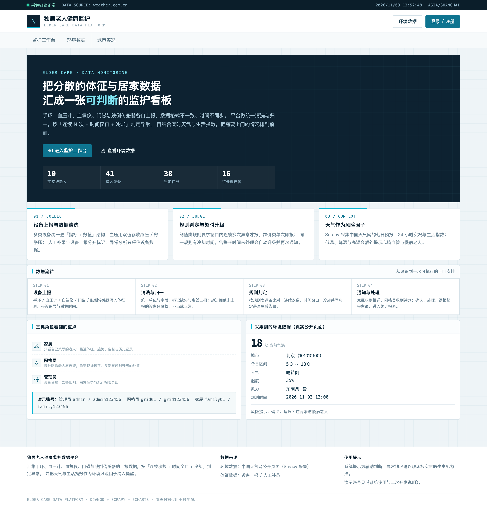
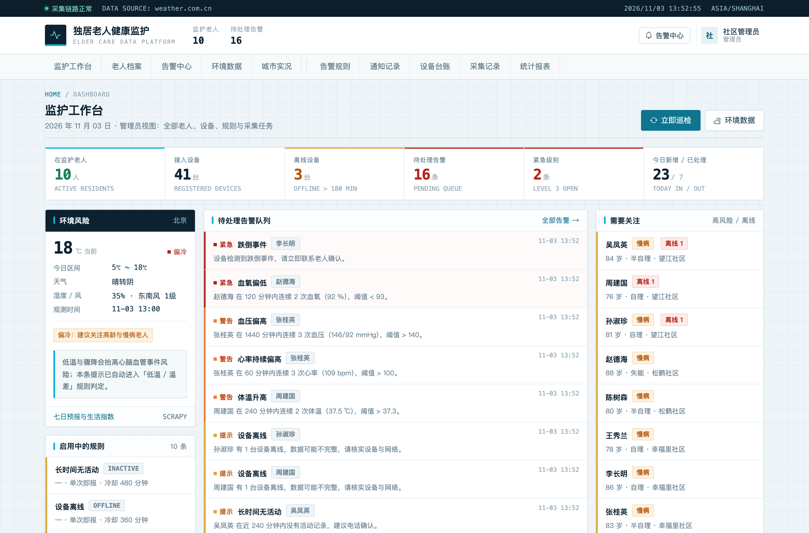
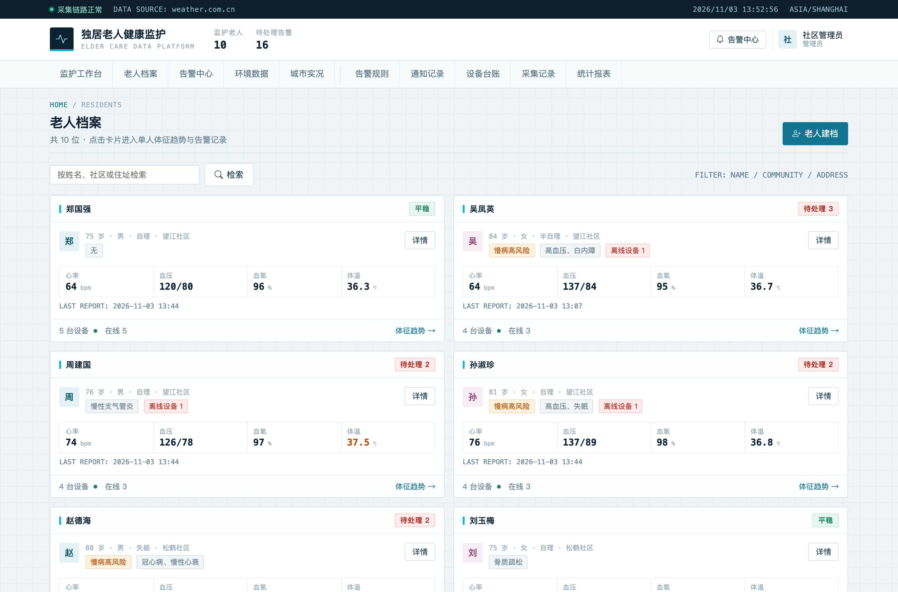
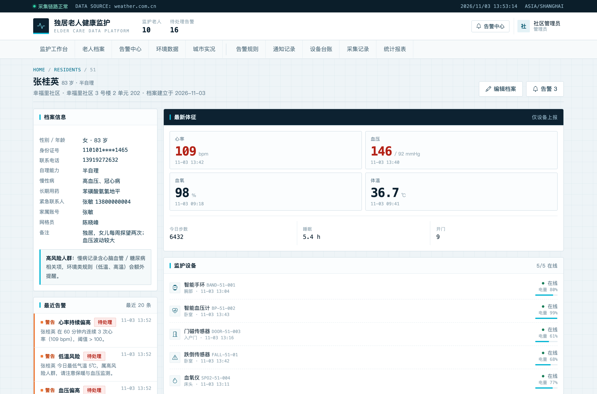
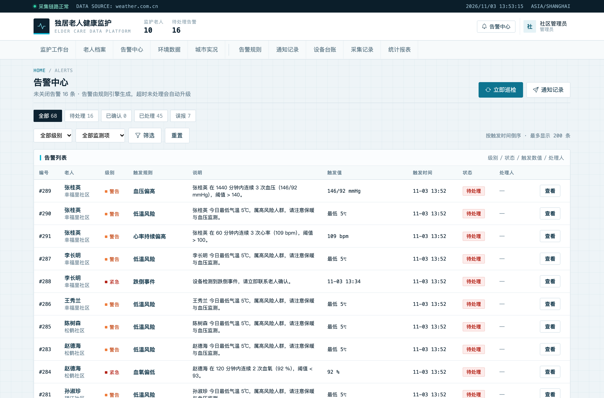
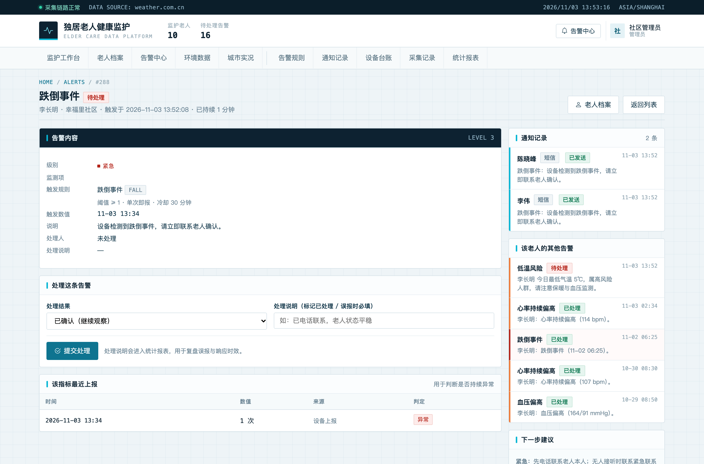
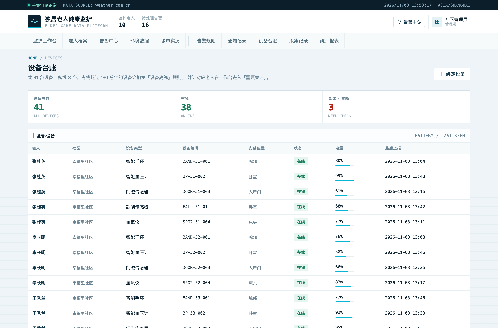
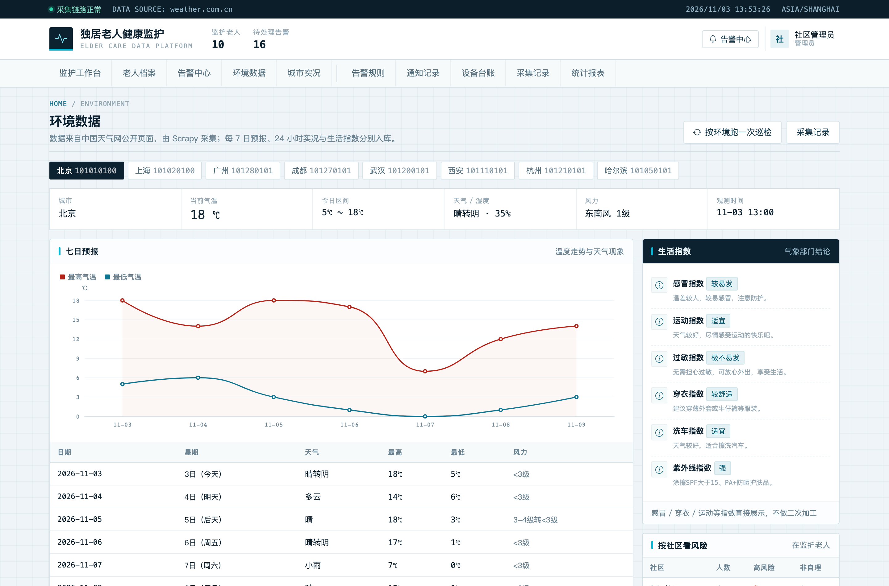
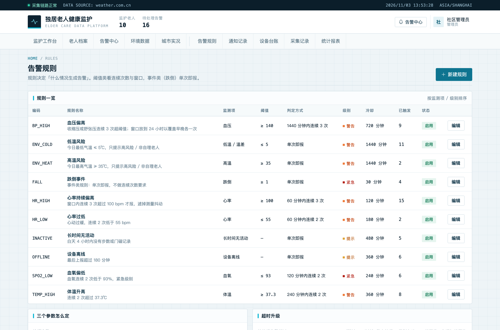
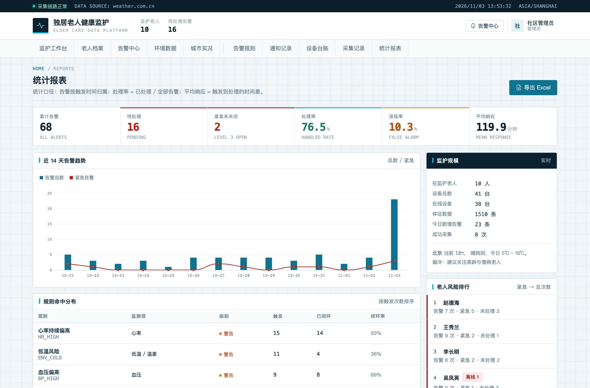

# 008 基于 Scrapy 与 Django 的独居老人健康监护数据平台-设计展示

> **代码有偿获取 可接受定制 微信联系方式: csbysj2020 或 ACE2487，备注(BS)**

> **完整源码与全套文档 · 在线自助获取 >>> [https://mbd.pub/o/bread/YZaWlJtsbA==](https://mbd.pub/o/bread/YZaWlJtsbA==)**

> **成品页（功能介绍 / 更多选题）>>> [https://bishe.suilang.net/products/django-elder-monitor](https://bishe.suilang.net/products/django-elder-monitor)**

> 

> 

## 视频

> **点击查看 >>> [https://www.bilibili.com/video/BV15J4g6sE1J/](https://www.bilibili.com/video/BV15J4g6sE1J/)**

## 项目简介

面向社区居家养老的独居老人健康监护数据平台：把手环、血压计、血氧仪、门磁与跌倒传感器的数据统一清洗入库，按「连续次数 + 时间窗口 + 冷却 + 超时升级」判定异常并通知家属与网格员；同时用 Scrapy 采集中国天气网的七日预报、24 小时实况与生活指数，把低温与高温作为心脑血管风险因子纳入提醒。

独居老人的体征与居家活动数据分散在不同厂商的设备与 App 中，缺少统一入口，异常情况往往只能依靠老人主动求助。

针对这一问题，本项目设计并实现了一套基于 Scrapy 与 Django 的独居老人健康监护数据平台，采用 B/S 架构与 Django 的 MVT 模式开发，数据库使用 MySQL（交付环境提供 SQLite 以便直接运行）。

平台以老人为单位建立档案并绑定智能手环、血压计、血氧仪、门磁与跌倒传感器，把多源数据统一清洗为「指标 + 数值」结构，血压采用双值存储，设备上报与人工补录分别标记；设备超过设定时长未上报即视为离线，作为数据缺失处理而不是「正常」。

本仓库为**设计展示**：包含项目说明、技术架构、实验结果与运行截图；完整源码、任务书、开题报告、毕业论文与使用说明可通过上方链接自助获取，成品页可查看更多选题，也可联系微信咨询定制。

## 功能特性

1. 三类角色：家属只看自己关联的老人；网格员按社区看并负责处理；管理员维护设备、规则与采集任务

2. 老人档案与设备台账：自理能力、慢病、紧急联系人；设备类型、电量、最后上报与在线 / 离线 / 故障

3. 体征数据清洗：心率 / 血压（双值）/ 血氧 / 体温 / 步数 / 睡眠 / 门磁 / 跌倒，区分设备上报与人工补录

4. 告警规则引擎：阈值类要求窗口内连续 N 次异常才报，跌倒单次即报；冷却期内不重复，超时未处理自动升级

5. 告警流转闭环：待处理 → 已确认 → 已处理 / 误报，处理留说明，每条告警都有通知记录

6. 环境数据真实采集：Scrapy 抓取中国天气网七日预报、3 小时预报、24 小时实况与生活指数，幂等入库并记录采集日志

7. 可视化看板：三栏监护工作台、近 7 天体征趋势、七日温度走势、24 小时温湿度曲线

8. 统计与导出：告警趋势、规则命中分布、老人风险排行，一键导出四张工作表 Excel

## 技术架构

| 项目 | 说明 |
| --- | --- |
| 编程语言 | Python 3.8 及以上 |
| Web 框架 | Django 4.2 |
| 采集框架 | Scrapy 2.11（采集中国天气网公开页面） |
| 数据库 | MySQL 5.7 及以上（交付默认 SQLite，免安装） |
| 可视化 | ECharts 5（已内置本地文件，离线可用） |
| 前端 | Bootstrap 5（已内置本地文件） |
| 报表导出 | openpyxl |
| 操作系统 | Windows / macOS / Linux |
| 启动方式 | 双击一键脚本，或 python manage.py runserver |

## 目录结构

以下为完整交付版的结构（本仓库仅作设计展示）：

```
django-elder-monitor/
├── 任务书/
│   └── 毕业设计任务书.docx
├── 开题报告/
│   └── 毕业设计开题报告.docx
├── 最终论文/
│   ├── 图/
│   │   ├── 图3-1_系统用例图.png
│   │   ├── 图4-1_系统架构图.png
│   │   ├── 图4-2_功能模块图.png
│   │   ├── 图4-3_告警判定流程图.png
│   │   ├── 图4-4_数据库ER图.png
│   │   └── 图4-5_数据采集流程图.png
│   └── 基于Scrapy与Django的独居老人健康监护数据平台设计.docx
├── 源码/
│   ├── accounts/
│   │   ├── migrations/
│   │   ├── __init__.py
│   │   ├── admin.py
│   │   ├── apps.py
│   │   ├── decorators.py
│   │   ├── forms.py
│   │   ├── models.py
│   │   ├── urls.py
│   │   └── views.py
│   ├── alerts/
│   │   ├── migrations/
│   │   ├── __init__.py
│   │   ├── admin.py
│   │   ├── apps.py
│   │   ├── forms.py
│   │   ├── models.py
│   │   ├── services.py
│   │   ├── urls.py
│   │   └── views.py
│   ├── crawler/
│   │   ├── tianqi/
│   │   └── scrapy.cfg
│   ├── eldermonitor/
│   │   ├── asgi.py
│   │   ├── context.py
│   │   ├── settings.py
│   │   ├── urls.py
│   │   └── …
│   └── …
└── …
```

## 数据与实验结论

- 平台还使用 Scrapy 采集中国天气网的公开数据，包括七日预报、逐 3 小时预报、24 小时实况与生活指数，按「城市 + 日期」幂等入库，并把低温、降温与高温作为心脑血管等环境风险的提示因子。
- 环境数据真实采集：Scrapy 抓取中国天气网七日预报、3 小时预报、24 小时实况与生活指数，幂等入库并记录采集日志
- 可视化看板：三栏监护工作台、近 7 天体征趋势、七日温度走势、24 小时温湿度曲线

## 交付内容

1. 完整源码（已跑通，含 10 位老人 / 41 台设备 / 1500+ 条体征演示数据）
2. Scrapy 采集工程与采集记录（天气数据为真实抓取）
3. 毕业设计任务书（Word）
4. 开题报告（Word）
5. 毕业论文（Word，七章制，含告警判定设计与采集设计章节）
6. 系统使用与二次开发说明（Word + md）
7. 10 张系统运行截图

## 常见问题

**项目能直接跑起来吗？**

能。交付包里已带数据库与演示数据，安装依赖后双击一键脚本或按说明启动即可；天气数据也已经采好一份，断网也能演示。

**数据是真实的吗？**

天气、七日预报、24 小时实况与生活指数由 Scrapy 从中国天气网真实采集，可在「采集记录」核对时间与条数；老人档案、设备与体征是程序生成的仿真数据，固定随机种子，不对应真实个人。

**告警为什么不是一超阈值就报？**

单次测量受姿势、佩戴松紧影响，容易误报。阈值类规则要求窗口内最新 N 条设备数据全部异常才触发；跌倒这类事件规则设为 1 次，单次即报，不会被连续次数拖延。

**冷却和升级是怎么做的？**

同一老人同一规则在冷却期内不重复新建告警，上一告警未处理时合并；待处理超过 30 分钟自动升级一级并再通知网格员，升级只发生一次。

**设备离线了会怎样？**

超过 180 分钟没有上报即视为离线，触发「设备离线」规则，并在设备台账与工作台标出；离线数据作为缺失处理，不会当成「正常」。

**为什么没有「立即采集」按钮？**

Scrapy 依赖 Twisted 的 reactor，同一进程只能启动一次，网页里二次启动会抛 ReactorNotRestartable。因此采集放在命令行与定时任务，页面上展示采集记录与命令说明，这也更符合真实系统的做法。

## 截图











